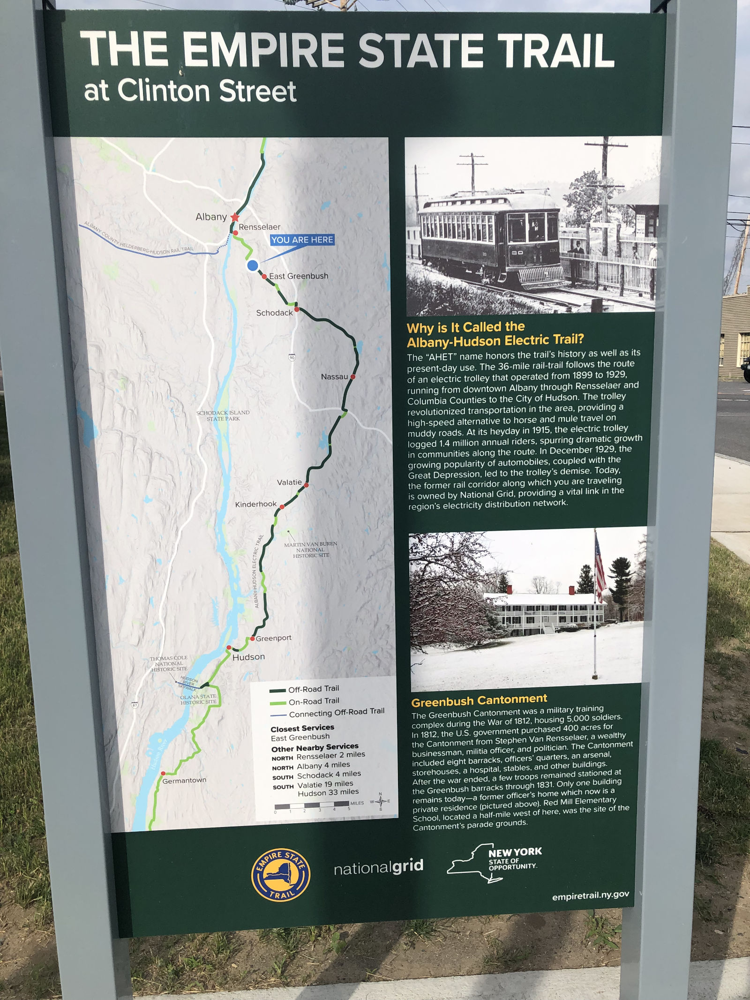
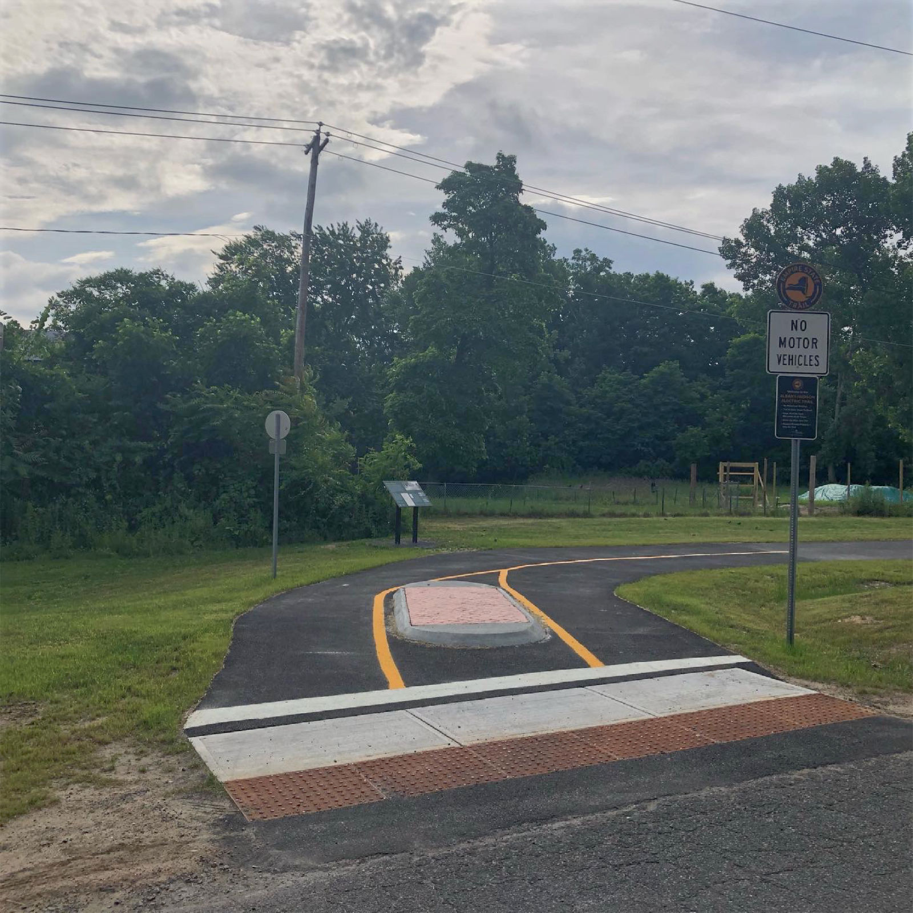
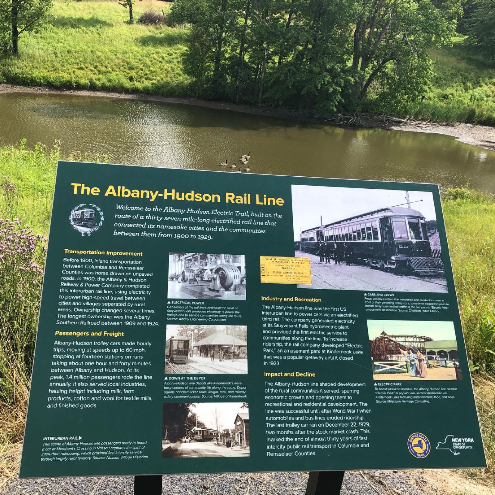
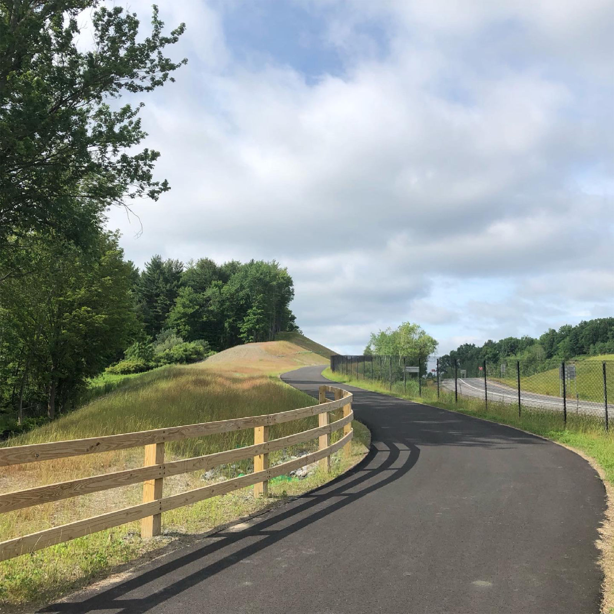
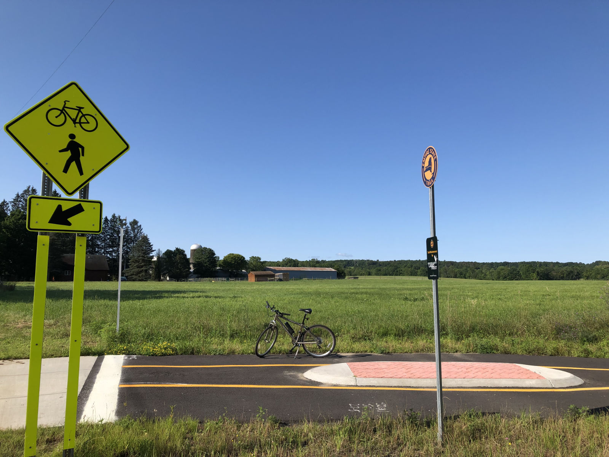
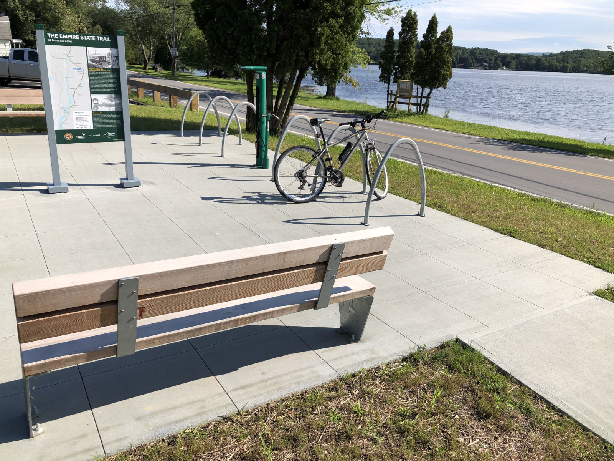

Part of the statewide Empire Trail system, the Albany-Hudson Electric Trail extends from Rensselaer south to Hudson. Most of the journey is on a dedicated paved trail, although sections overlap with area roads. This trail is perfect for biking, running, rollerblading, or walking, as well as cross-country skiing in the winter.

In total, the trail runs for 36 miles, following the path once taken by the Albany-Hudson Rail Line. The setting varies from city and suburban vibes heading from Rensselaer through East Greenbush to wooded terrain and a country feel as you go further south.

Several dedicated parking areas exist throughout the trail, from larger lots to some smaller pulloffs. Popular parking spots include a lot just off the Columbia Turnpike in Rensselaer, Nassau Lake, Kinderhook Village Park, Stuyvesant Falls Park, and the end point off Dock Street in Hudson.

This trail also connects to the Mohawk-Hudson Bike-Hike trail via road if you'd like to make a longer route. You can also continue south of Hudson on-road before connecting to further dedicated trail.

<h2>Albany-Hudson Electric Trail  Photos</h2>

 
 
 
 
 
 

<a href="https://empiretrail.ny.gov/poughkeepsie-albany/nassau-east-greenbush" target="_blank">See a detailed trail map courtesy of the official Empire Trail site, as well as cue sheets highlighting key interchanges with roads.</a>

